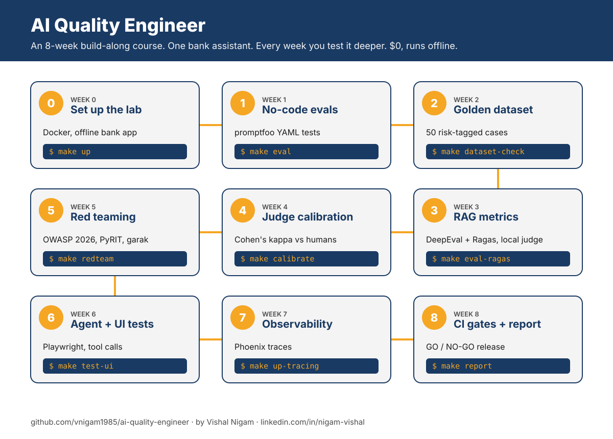
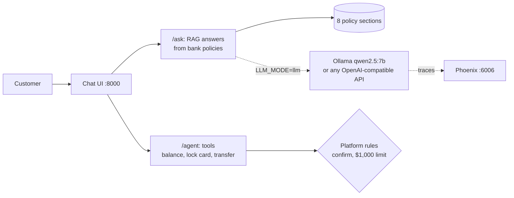

# AI Quality Engineer: the 8-week build-along course

**Go from QA or test engineer to AI Quality Engineer by testing one real AI system, week by week, for $0.**

[](COSTS.md)
[](COSTS.md)
[](COSTS.md)
[](redteam/owasp-mapping.md)
[](LICENSE)

<p align="left">
  <a href="https://www.linkedin.com/in/nigam-vishal/"></a>
  <a href="https://www.youtube.com/@thrivewithvishal"></a>
  <a href="https://www.instagram.com/thrivewithvishal"></a>
  <a href="https://vnigam1985.github.io"></a>
  <a href="https://mentoraccelerate.com/90-day-job-search-framework"></a>
</p>

AI is changing QA work fast. The testers who do well won't be the ones who fight it. They'll be the ones who can **prove whether an AI system is safe to ship**. This repo teaches that skill by doing it.

You get a small but realistic **bank assistant** (a RAG chatbot plus a tool-calling agent that can move money). Each week you test it in a new way, and each week leaves you with a portfolio piece and a resume bullet.



<sub>[Download the roadmap as PDF](assets/roadmap.pdf)</sub>

## Who this is for

- QA, test and automation engineers who want to move into AI testing
- Manual testers who are **new to Python**. Weeks 0 to 2 need almost no code, and every script is short and commented
- Anyone hiring for, or doing, LLM evaluation in a regulated industry like banking

## Quickstart (60 seconds)

```bash
git clone https://github.com/vnigam1985/ai-quality-engineer.git
cd ai-quality-engineer
make setup && make up && make health && make eval
```

You should see `"status":"ok"` and **10 passed**. No API keys. No model download. That's week 0 and the start of week 1 done.

Need Python 3.11+, Node.js 20+ and Docker. No Docker? Use `make run` instead of `make up`. Details in [week 0](weeks/00-setup/README.md).

## The course

| Week | Topic | You learn | Command | Tag | Cost |
| --- | --- | --- | --- | --- | --- |
| 0 | [Set up the lab](weeks/00-setup/README.md) | Run and read the system under test | `make up` | `week-00` | $0 |
| 1 | [No-code evals](weeks/01-no-code-evals/README.md) | promptfoo YAML tests, catching a regression | `make eval` | `week-01` | $0 |
| 2 | [Golden dataset](weeks/02-golden-dataset/README.md) | Risk-tagged test data, validation | `make dataset-check` | `week-02` | $0 |
| 3 | [RAG metrics](weeks/03-rag-metrics/README.md) | Faithfulness, relevancy, context precision and recall with DeepEval and Ragas | `make eval-ragas` | `week-03` | $0 (local model) |
| 4 | [Judge calibration](weeks/04-judge-calibration/README.md) | LLM-as-judge vs humans, Cohen's kappa | `make calibrate` | `week-04` | $0 |
| 5 | [Red teaming](weeks/05-red-teaming/README.md) | OWASP LLM Top 10 2026, promptfoo, PyRIT, garak | `make redteam` | `week-05` | $0 |
| 6 | [Agent and UI testing](weeks/06-agent-and-ui-testing/README.md) | Tool-call tests with Playwright | `make test-ui` | `week-06` | $0 |
| 7 | [Observability](weeks/07-observability/README.md) | Tracing with Arize Phoenix | `make up-tracing` | `week-07` | $0 |
| 8 | [CI gates and release report](weeks/08-quality-report/README.md) | GitHub Actions gates, GO / NO-GO report, OSFI E-23 | `make report` | `week-08` | $0 |

Each week's folder has: goal, diagram, steps, a "check your work" list, the portfolio artifact, a resume bullet and links to go deeper. Plan 6 to 10 hours a week.

**Jump to any week's starting code:** `git checkout week-03` (tags `week-00` to `week-08`). `make help` lists every command.

## What you're testing



Two modes:

- **offline** (default): no model. Answers are copied from the best-matching policy section. Free, fast, predictable. Perfect for learning test design and for CI
- **llm**: a real model through Ollama on your laptop, or any OpenAI-compatible endpoint. This is where hallucinations, flaky answers and jailbreaks show up

## Services and ports

| Service | Port | Started by |
| --- | --- | --- |
| Bank assistant (API + chat UI) | 8000 | `make up` / `make run` |
| Ollama (local model) | 11434 | `make up-llm` |
| Arize Phoenix (traces) | 6006 (UI), 4317 (OTLP gRPC) | `make up-tracing` |

## Repo map

```
app/            the bank assistant you test (FastAPI) and its policy docs
datasets/       golden dataset and human labels
evals/          promptfoo, DeepEval, Ragas, judge calibration, quality_gates.yaml
redteam/        hand-written attacks, promptfoo red team, PyRIT, garak, OWASP mapping
tests/          Playwright API, agent and UI tests
observability/  tracing cheat sheet
scripts/        dataset validator, gate, release report
reports/        generated reports (sample included)
weeks/          the lessons
.github/        PR (offline) and nightly (local LLM judge) workflows
```

## Tools you'll use

| Tool | What for | Week |
| --- | --- | --- |
| [promptfoo](https://www.promptfoo.dev/docs/getting-started/) | YAML evals and red teaming | 1, 5, 8 |
| [DeepEval](https://deepeval.com/docs/getting-started) | Pytest-style LLM metrics | 3 |
| [Ragas](https://docs.ragas.io/en/stable/concepts/metrics/available_metrics/faithfulness/) | RAG metrics | 3 |
| [Ollama](https://ollama.com) | Free local model and judge | 3+ |
| [PyRIT](https://github.com/microsoft/PyRIT) and [garak](https://github.com/NVIDIA/garak) | Attack scripting and scanning | 5 |
| [Playwright for Python](https://playwright.dev/python/docs/api-testing) | API, agent and UI tests | 6 |
| [Arize Phoenix](https://arize.com/docs/phoenix/tracing/llm-traces) | Tracing | 7 |
| GitHub Actions | Quality gates in CI | 8 |

## More in this repo

- [resources.md](resources.md): well-reviewed courses (with ratings) and official docs
- [certifications.md](certifications.md): ISTQB CT-GenAI and CT-AI, and which to take first
- [interview/README.md](interview/README.md): 15 interview questions with answers built on this project
- [COSTS.md](COSTS.md): why it's $0, and the optional costs
- [TROUBLESHOOTING.md](TROUBLESHOOTING.md): fixes for the common errors
- [VERIFICATION.md](VERIFICATION.md): exactly what was tested before publishing, and what wasn't
- [AGENTS.md](AGENTS.md): instructions for AI coding assistants helping you with this repo

## Stuck?

1. Check [TROUBLESHOOTING.md](TROUBLESHOOTING.md)
2. Open an issue with the **I'm stuck** template
3. Found a fix? Pull requests are welcome, see [CONTRIBUTING.md](CONTRIBUTING.md)

---

## 👋 About the author

**Vishal Nigam** is a Senior Cloud Engineer and Azure SME with 18+ years in enterprise IT. He builds cloud platforms, landing zones, network security and guardrails for large regulated companies, and now helps engineers move into AI platform work.

He came to Canada in 2017 with $5,000, a wife, a 4-year-old son and zero connections. He has since landed 6 job offers in Canada without a single direct application. No one handed him a playbook, so he built one, and he shares it for free.

He teaches systems, strategy and execution. Not motivation.

### Follow for more

| Where | What you get |
| --- | --- |
| [LinkedIn](https://www.linkedin.com/in/nigam-vishal/) | Azure platform engineering, cloud careers and job search, posted several times a week |
| [YouTube](https://www.youtube.com/@thrivewithvishal) | Long-form videos on cloud careers and platform engineering |
| [Instagram @thrivewithvishal](https://www.instagram.com/thrivewithvishal) | Cloud career tips and the personal journey |
| [Instagram @mentoraccelerate](https://www.instagram.com/mentoraccelerate) | Cloud, DevOps, job search and interview tips |
| [Instagram @cloudwithvishal](https://www.instagram.com/cloudwithvishal) | Cloud Episodes in Hindi, cloud interview reels |
| [Instagram @cloudwithvishal.en](https://www.instagram.com/cloudwithvishal.en) | Cloud Episodes in English |
| [X](https://x.com/thrivewidvishal) | Quick takes on cloud and AI |
| [Facebook](https://www.facebook.com/people/Vishal-Nigam/61565195962651/) | Updates and videos |
| [Portfolio](https://vnigam1985.github.io) | Projects and experience |
| [GitHub](https://github.com/vnigam1985) | More free roadmaps and templates |
| [All links](https://linktr.ee/nigamv) | Everything in one place |

### Free resources

- 📘 **[90-Day Job Search Framework](https://mentoraccelerate.com/90-day-job-search-framework)**: the step-by-step system for landing a cloud role, free
- 🤝 **[MentorAccelerate Cloud Career Community waitlist](https://mentoraccelerate.com/cloudcareercommunitywaitlist)**: a place to prepare for cloud roles and get help from working cloud engineers

### More free roadmaps by Vishal

| Repo | For |
| --- | --- |
| [azure-ai-platform-architect](https://github.com/vnigam1985/azure-ai-platform-architect) | Becoming an AI Platform Architect on Microsoft Azure |
| [aws-ai-platform-architect](https://github.com/vnigam1985/aws-ai-platform-architect) | Becoming an AI Platform Architect on AWS |
| [gcp-ai-platform-architect](https://github.com/vnigam1985/gcp-ai-platform-architect) | Becoming an AI Platform Architect on Google Cloud |
| [ai-quality-engineer](https://github.com/vnigam1985/ai-quality-engineer) | QA and test engineers moving into AI and LLM testing |

If this repo helped you, **star it**, and tell Vishal on LinkedIn what you built with it.
