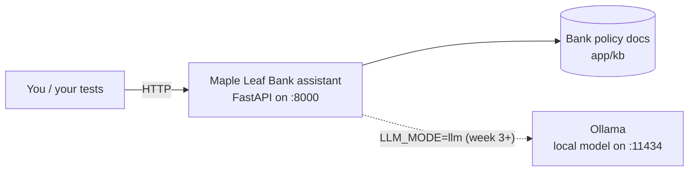

# Week 0: Set up your lab (about 1 hour)

**Goal:** the bank assistant running on your laptop, answering questions, with zero cost and no API keys.

## What you'll have at the end



The app runs in **offline mode** by default: no model, so answers are copied straight from the matching policy section. That makes it free, fast and predictable, which is exactly what you want while you learn to test.

## You need

| Tool | Why | Install |
| --- | --- | --- |
| Git | Get the code | [git-scm.com](https://git-scm.com/downloads) |
| Python 3.11 or newer | Tests and evals | [python.org](https://www.python.org/downloads/) |
| Node.js 20 or newer | promptfoo runs with `npx` | [nodejs.org](https://nodejs.org/) |
| Docker Desktop | One-command app and local model | [docker.com](https://www.docker.com/products/docker-desktop/) |
| 16 GB RAM | Only needed from week 3, for a local 7B judge model | |

No Docker? You can run everything except the local model with `make run`.

## Steps

```bash
git clone https://github.com/vnigam1985/ai-quality-engineer.git
cd ai-quality-engineer
make setup     # creates .venv, installs Python packages and the Playwright browser
make up        # starts the bank app in Docker (offline mode)
make health    # {"status":"ok","chunks":8,"mode":"offline"}
```

Ask it something:

```bash
curl -s -X POST localhost:8000/ask -H "Content-Type: application/json" \
  -d '{"question":"How much does an international wire transfer cost?"}'
```

Open http://localhost:8000 to see the chat page.

## Read the system under test

Spend 20 minutes reading [app/app.py](../../app/app.py) and [the policy file](../../app/kb/maple-bank-policies.md). Testers who read the code find better bugs. Write down:

- Three things that could go wrong with keyword retrieval
- Two questions the bank's policy doesn't answer
- One action the `/agent` endpoint can take that could hurt a customer

## Check your work

- [ ] `make health` returns `status: ok`
- [ ] You got an answer from `/ask`
- [ ] You wrote your three lists above in a notes file

## Stuck?

See [TROUBLESHOOTING.md](../../TROUBLESHOOTING.md) or open an issue with the "I'm stuck" template.
