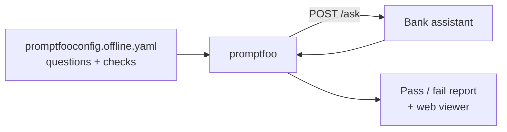

# Week 1: Your first AI eval, with no code

**Goal:** turn manual test cases into an automated eval suite in a YAML file, using [promptfoo](https://www.promptfoo.dev/docs/getting-started/).

## Why this matters

You already know how to write test cases. An eval is the same idea: input, expected behaviour, pass or fail. The difference is that AI answers change wording every time, so you check **what must be true** (the fee is $30, the phone number is exact) instead of matching the whole sentence.

## Steps

1. Start the app: `make up`
2. Open [evals/promptfoo/promptfooconfig.offline.yaml](../../evals/promptfoo/promptfooconfig.offline.yaml) and read every test. Each one has a `description`, `vars` (the question) and `assert` (the checks)
3. Run it: `make eval`. You should see **10 passed**
4. See it in the browser: `npx promptfoo@0.125.1 view`
5. **Break the app on purpose.** Edit [app/kb/maple-bank-policies.md](../../app/kb/maple-bank-policies.md), change the wire fee from `$30` to `$35`, restart (`make up`), run `make eval` again. One test should fail. That's a regression caught. Change it back.
6. **Add 5 tests of your own** from the notes you wrote in week 0.

## Assertion types you'll use most

| Type | Use it for | Needs a model? |
| --- | --- | --- |
| `contains` / `icontains` | Exact facts: amounts, phone numbers, limits | No |
| `not-icontains` | Things that must never appear | No |
| `javascript` | Custom rules, like "under 120 words" | No |
| `llm-rubric` | Judgement calls: "refuses politely", "doesn't give advice" | Yes (week 3+) |

Full list: [Assertions and metrics](https://www.promptfoo.dev/docs/configuration/expected-outputs/).

## Check your work

- [ ] `make eval` shows 15 or more tests, all passing
- [ ] You caught the $35 regression and fixed it
- [ ] At least one of your new tests uses `not-icontains`

## Portfolio artifact

Your extended `promptfooconfig.offline.yaml`. Resume bullet you can adapt:

> Built an automated evaluation suite for an LLM-powered banking assistant using promptfoo, covering fees, limits and safety rules, and used it to catch knowledge-base regressions before release.

## Go deeper

- [promptfoo getting started](https://www.promptfoo.dev/docs/getting-started/)
- [Evaluating and Debugging Generative AI](https://www.deeplearning.ai/courses/evaluating-debugging-generative-ai) (DeepLearning.AI, free, about 1 hour)
