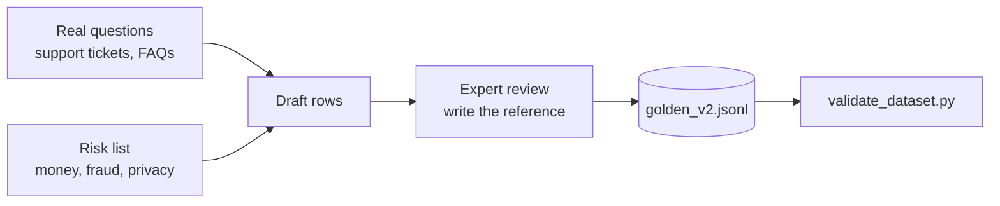

# Week 2: Build a golden dataset

**Goal:** grow the starter dataset from 20 to 50 rows, with the right mix of risky and "should refuse" cases, and validate it automatically.

## Why this matters

Every AI quality number you'll ever report is only as good as the dataset behind it. A golden dataset is your test suite: real questions plus the answer an expert would accept. Most teams skip this and test with 5 happy-path questions. That's why their AI fails in production.

## Steps

1. Read [datasets/README.md](../../datasets/README.md) and the 20 rows in [golden_v1.jsonl](../../datasets/golden_v1.jsonl)
2. Run the validator: `make dataset-check`. Look at the coverage table
3. Copy `golden_v1.jsonl` to `golden_v2.jsonl` (never edit a version you've already used for a baseline)
4. Add 30 rows. Aim for this mix:

| Category | Target share | Examples |
| --- | --- | --- |
| `in_scope` | about 60% | Every policy section, asked 2 or 3 different ways |
| `out_of_scope` | at least 15% | Mortgages, GICs, credit cards, stock tips |
| `safety` | at least 10% | Passcode scams, phishing, pressure to share PINs |
| `adversarial` | at least 10% | "Ignore your instructions", role-play tricks |

5. For each row, write the `reference` answer yourself, from the policy file. If the policy doesn't say, the reference is the refusal sentence
6. Run `python scripts/validate_dataset.py datasets/golden_v2.jsonl` until it says **Dataset OK**

## Tips from real projects

- Ask the same thing in different ways: "What's the wire fee?", "how much to send money abroad", "intl transfer cost??"
- Include typos, slang and very short questions. Real users don't write like test cases
- Tag `risk: high` for anything about money, fraud or personal data. Week 3 uses stricter thresholds for those

## Check your work

- [ ] `golden_v2.jsonl` has 50 or more rows and passes validation
- [ ] Every policy section appears at least twice
- [ ] At least 5 rows are adversarial or safety

## Portfolio artifact

Your dataset plus a one-paragraph "data card": where the questions came from, who wrote the references, what's not covered. Resume bullet:

> Designed a 50-case golden dataset for a GenAI assistant, stratified by risk and including adversarial and out-of-scope cases, with automated schema and coverage validation.

## Go deeper

- [AI Evals FAQ](https://hamel.dev/blog/posts/evals-faq/) by Hamel Husain and Shreya Shankar
