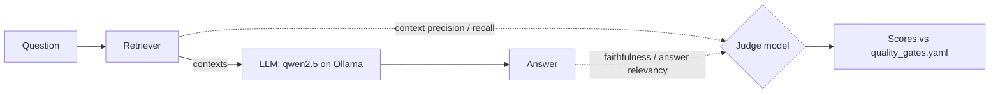

# Week 3: Measure RAG quality with DeepEval and Ragas

**Goal:** switch the app to a real local model and score it on the four classic RAG metrics, with a judge model that also runs locally.

## Why this matters

A RAG app can fail in two places: **retrieval** (it fetched the wrong policy) and **generation** (it had the right policy but said something else). You need metrics that tell them apart, or you'll fix the wrong thing.

| Metric | Question it answers | Failure it catches |
| --- | --- | --- |
| Faithfulness | Is every claim in the answer supported by the retrieved text? | Hallucination |
| Answer relevancy | Does the answer address the question? | Rambling, dodging |
| Context precision | Is the retrieved text relevant? | Noisy retrieval |
| Context recall | Did retrieval get everything the reference needs? | Missing information |

## Steps

1. Start the app with a local model: `make up-llm` (first run downloads about 5 GB). Then `docker compose exec ollama ollama pull nomic-embed-text` for Ragas embeddings
2. Run DeepEval: `make eval-deepeval`. It runs [test_rag_quality.py](../../evals/deepeval/test_rag_quality.py), which works like pytest
3. Run Ragas: `make eval-ragas`. Scores are saved to `reports/ragas.json`
4. **Record your baseline.** Write the four mean scores in your notes. These numbers, not gut feel, should set the thresholds in [evals/quality_gates.yaml](../../evals/quality_gates.yaml)
5. **Find a retrieval bug.** Look for low context precision rows. Hint: keyword retrieval struggles when the question uses different words than the policy

## Honest warning about local judges

Small local models sometimes return badly formatted judgements, and scores can move a little between runs. That's normal. Week 4 is all about measuring how much you can trust the judge. If a metric errors, re-run it, or set `JUDGE_MODEL` to a bigger model.

## Check your work

- [ ] Both DeepEval and Ragas ran and you have a baseline for all four metrics
- [ ] You found at least one row where retrieval, not generation, caused the failure
- [ ] You updated `quality_gates.yaml` from your baseline and wrote down why

## Portfolio artifact

A one-page baseline report: four metrics, the worst 3 questions, and the root cause of each. Resume bullet:

> Measured RAG faithfulness, answer relevancy, context precision and recall with DeepEval and Ragas using a local judge model, separating retrieval defects from generation defects.

## Go deeper

- [DeepEval quickstart](https://deepeval.com/docs/getting-started) and [Faithfulness metric](https://deepeval.com/docs/metrics-faithfulness)
- [Ragas documentation](https://docs.ragas.io/en/stable/concepts/metrics/available_metrics/faithfulness/)
- [Building and Evaluating Advanced RAG](https://www.deeplearning.ai/courses/building-evaluating-advanced-rag) (DeepLearning.AI, free)
