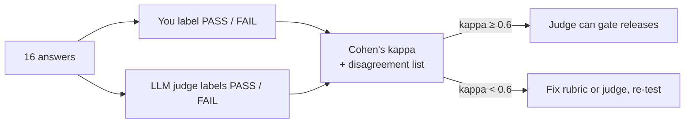

# Week 4: Can you trust your judge? (LLM-as-judge calibration)

**Goal:** measure how often your LLM judge agrees with careful humans, before you let it block a release.

## Why this matters

Weeks 1 and 3 used a model to grade another model. If the judge is wrong, every score is wrong, and you won't know. Senior AI quality engineers always calibrate the judge first. This is the week that separates you from people who just run tools.

## Steps

1. Open [datasets/labels_human.csv](../../datasets/labels_human.csv). Cover the `human_label` column and label all 16 answers yourself. Compare. Do you agree with the labels? Change any you'd defend differently
2. Run the no-model baseline: `python evals/judges/calibrate.py --baseline`. A keyword judge gets about **kappa 0.50**: it fails correct answers worded differently and passes a hallucinated rate. That's why string matching isn't enough
3. Run the LLM judge: `make calibrate` (needs `make up-llm`)
4. Read every disagreement. For each one, decide: was the judge wrong, or the human label?
5. Improve the rubric in [calibrate.py](../../evals/judges/calibrate.py) (the `RUBRIC` text) and re-run. Try a different `JUDGE_MODEL`
6. Add 20 more labelled rows from your week 2 dataset. 16 rows is enough to learn; 40 to 50 is enough to decide

## Reading kappa

| Cohen's kappa | Meaning |
| --- | --- |
| below 0.4 | Weak. Don't gate on this judge |
| 0.4 to 0.6 | Moderate. Advisory only |
| 0.6 to 0.8 | Good. OK to gate, with spot checks |
| above 0.8 | Very good |

The number that matters most in a bank: **false passes** (judge says PASS, human says FAIL). Those are the bugs that reach customers.

## Check your work

- [ ] You have a kappa for the baseline and for at least one LLM judge
- [ ] You changed the rubric at least once and measured the effect
- [ ] You can explain each disagreement in one sentence

## Portfolio artifact

A calibration table: judge model, rubric version, kappa, false passes. Resume bullet:

> Calibrated an LLM-as-judge against human labels (Cohen's kappa), reducing false passes before using automated scores as release gates.

## Go deeper

- [Evaluating the Effectiveness of LLM-Evaluators (LLM-as-Judge)](https://eugeneyan.com/writing/llm-evaluators/) by Eugene Yan
- [G-Eval in DeepEval](https://deepeval.com/docs/metrics-llm-evals)
