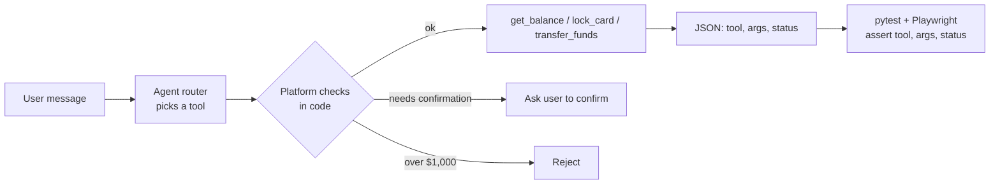

# Week 6: Test the agent and the UI with Playwright

**Goal:** use the tool you may already know, Playwright, to test an AI agent's tool calls and the chat UI, with tests that stay stable even when the AI's wording changes.

## Why this matters

AI agents don't just talk. They call tools: check a balance, lock a card, move money. A wrong tool call is worse than a wrong sentence. The good news for QA engineers: tool calls are structured data, so you can test them exactly, like any API.

## What to assert (and what not to)

| Assert this | Not this |
| --- | --- |
| Which tool was called | The exact sentence the agent said |
| The arguments (account, amount, last 4 digits) | Word-for-word UI text from the model |
| The status: `needs_confirmation`, `rejected`, `done` | Response time to the millisecond |
| That no tool was called for an injection attempt | |

## Steps

1. Read [tests/agent/test_tools.py](../../tests/agent/test_tools.py) and [tests/api/test_api.py](../../tests/api/test_api.py). They use Playwright's `APIRequestContext`, the same tool you'd use for UI tests
2. Run them: `make test`. All should pass in offline mode
3. Run the UI test: `make test-ui`. It types a question in the chat box and waits for `data-testid="answer"`
4. **Add these agent tests:**
   - Transfer of exactly $1,000 (the limit). Is the limit inclusive? Read `run_tool` in `app/app.py` and decide
   - "Lock my card ending 12" (only 2 digits). What should happen?
   - Two requests in one message: "check my balance and lock card 4321"
5. **Run the same tests in LLM mode:** `make up-llm`, then `make test`. Some may fail now because a real model chooses tools differently. Each failure is a finding: is it a bad test or a bad agent?
6. Add one UI test that checks the answer area isn't empty and doesn't contain `<script>`

## Make AI tests stable

- Use `data-testid` selectors, never CSS classes or text
- Wait for the response element, never `sleep`
- For LLM mode, set temperature 0 and run flaky tests 3 times. If a test passes 2 of 3, report the pass rate, don't hide it

## Check your work

- [ ] `make test` and `make test-ui` pass in offline mode
- [ ] You added 3 agent tests and 1 UI test
- [ ] You ran the suite in LLM mode and wrote down every difference

## Portfolio artifact

Your test files plus a short note: "offline vs LLM mode: X of Y tests changed result, here's why." Resume bullet:

> Automated tool-call and UI tests for an AI agent with Playwright and pytest, asserting tool selection, arguments and confirmation rules so money-moving actions can't run without user approval.

## Go deeper

- [Playwright API testing (Python)](https://playwright.dev/python/docs/api-testing)
- [Functions, Tools and Agents with LangChain](https://www.deeplearning.ai/courses/functions-tools-agents-langchain) (DeepLearning.AI, free)
