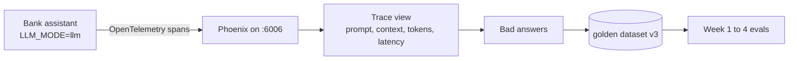

# Week 7: See inside the AI with tracing (Arize Phoenix)

**Goal:** trace every question through retrieval and the model, find slow and costly calls, and turn production traces into new test cases.

## Why this matters

When an AI answer is wrong in production, "it hallucinated" isn't a bug report. A trace shows exactly what was retrieved, what prompt went to the model, how many tokens it used and how long it took. That turns guessing into debugging. It also closes the loop: bad production answers become new rows in your golden dataset.



## Steps

1. Start the app, model and Phoenix: `make up-tracing` (this also starts Ollama)
2. Open http://localhost:6006
3. Ask 10 questions at http://localhost:8000, including 3 that should be refused
4. In Phoenix, open the `maple-bank-assistant` project. For each trace, find:
   - The exact prompt sent to the model
   - Input and output token counts
   - Total latency
5. Find the slowest trace. Is the time in retrieval or in the model?
6. Find one answer you think is wrong. Add it to `datasets/golden_v3.jsonl` with the correct reference. This is how real teams grow their datasets

## How tracing is wired

Tracing is optional and only turns on when `PHOENIX_COLLECTOR_ENDPOINT` is set. In [app/app.py](../../app/app.py):

```python
from phoenix.otel import register
from openinference.instrumentation.openai import OpenAIInstrumentor

OpenAIInstrumentor().instrument(tracer_provider=register(project_name="maple-bank-assistant"))
```

Every OpenAI-compatible call (including Ollama's) becomes a span. Packages: [requirements-tracing.txt](../../requirements-tracing.txt).

## What to watch in production

| Signal | Why it matters | Example alert |
| --- | --- | --- |
| Refusal rate | A sudden jump often means retrieval broke | Above 2x the weekly average |
| Tokens per answer | Cost, and a sign of rambling | p95 above 600 tokens |
| Latency p95 | User experience | Above 8 seconds |
| Thumbs-down rate | Real user quality signal | Above 5% for a day |

## Check your work

- [ ] You found the prompt, tokens and latency for at least 3 traces
- [ ] You know whether retrieval or the model is the slow part
- [ ] You added at least 2 production-style rows to a v3 dataset

## Portfolio artifact

Screenshots of 2 traces with one paragraph each: what went wrong and what test you added. Resume bullet:

> Instrumented a RAG assistant with OpenTelemetry and Arize Phoenix to trace prompts, token usage and latency, and turned production failures into regression test cases.

## Go deeper

- [Phoenix tracing docs](https://arize.com/docs/phoenix/tracing/llm-traces)
- [OpenInference](https://github.com/Arize-ai/openinference)
