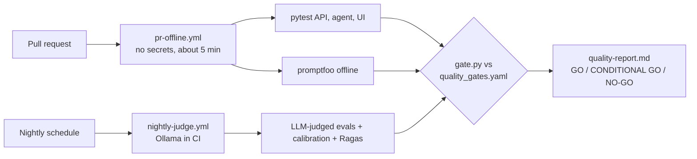

# Week 8: CI quality gates and the release report

**Goal:** put everything into GitHub Actions so every pull request is tested automatically, and produce the one-page GO / NO-GO report a release manager or model risk team actually reads.

## Why this matters

Tools don't get you hired. Decisions do. The AI quality engineer is the person who says "this model can ship" or "it can't, and here's why", with numbers. In Canadian banks, OSFI Guideline E-23 (in force May 1, 2027) expects every model, including AI, to be inventoried, validated and monitored. Your report is that evidence.

## Steps

1. Read [.github/workflows/pr-offline.yml](../../.github/workflows/pr-offline.yml). It needs **no API keys**, so it works on forks and costs $0
2. Read [.github/workflows/nightly-judge.yml](../../.github/workflows/nightly-judge.yml). It starts Ollama as a service, pulls the model and runs the judged evals
3. Fork this repo, push a branch, open a pull request to your fork. Watch the checks run
4. **Break a gate on purpose:** change the wire fee in the policy file, push, and watch the PR go red. That screenshot is gold for interviews
5. Run locally: `make eval && make gate && make report`, then open `reports/quality-report.md`
6. Read [reports/sample-quality-report.md](../../reports/sample-quality-report.md) and edit the "Scope" and "Known limitations" sections for your version

## What makes a good release report

- One decision at the top: GO, CONDITIONAL GO or NO-GO
- Every gate with its threshold and actual score
- How much you trust the judge (kappa from week 4)
- Open security findings by severity (week 5)
- What was **not** tested. Honest gaps build trust
- A model inventory entry: owner, model, version, use, risk tier, last validated

## Check your work

- [ ] Your fork shows a green PR check and a red one you caused on purpose
- [ ] `make report` writes a report with a decision
- [ ] You can explain each gate threshold and where it came from

## Portfolio artifact

The whole repo on your GitHub, a link to a PR with the checks, and your quality report. Resume bullets:

> Built CI quality gates for a GenAI application in GitHub Actions, running deterministic evals on every pull request and LLM-judged evals nightly with a local model, at zero API cost.

> Produced GO / NO-GO release reports combining RAG metrics, judge calibration and red team findings, aligned to model risk management expectations (OSFI E-23).

## You finished. Now what?

1. Pin this repo on your GitHub profile and write a LinkedIn post about one bug you found
2. Practise the questions in [interview/README.md](../../interview/README.md)
3. Check the certifications in [certifications.md](../../certifications.md)

## Go deeper

- [OSFI Guideline E-23: Model Risk Management](https://www.osfi-bsif.gc.ca/en/guidance/guidance-library/guideline-e-23-model-risk-management-2027)
- [NIST AI Risk Management Framework](https://www.nist.gov/itl/ai-risk-management-framework)
